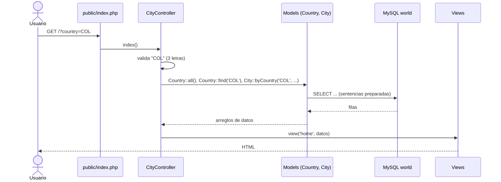

# Ciudades del mundo – Prueba Analista de Soporte Nivel 1 (Infodec)

Aplicación web responsive (PC, tablet y celular) que permite seleccionar un país
y ver sus ciudades con la población de cada una, el **Top 10 de las más pobladas** y el
**Top 10 de las menos pobladas**.

| Documento | Contenido |
|---|---|
| [docs/respuestas.md](docs/respuestas.md) | Respuestas de las preguntas 1 a 5 |
| [docs/diagrama-bd.md](docs/diagrama-bd.md) | Diagrama entidad-relación de la BD `world` |
| [database/consultas.sql](database/consultas.sql) | Queries de la pregunta 2 |
| [docs/pregunta4-apis.md](docs/pregunta4-apis.md) | APIs, errores encontrados y su solución |
| [postman/](postman/) | Colección de Postman |

## Tecnologías

- **PHP 8.x** sin framework, siguiendo el patrón **MVC**.
- **MySQL 8** con la base de datos de ejemplo [`world`](https://dev.mysql.com/doc/world-setup/en/).
- **PDO** con sentencias preparadas para el acceso a datos.
- HTML + CSS (*mobile first*, sin librerías) y un poco de JavaScript.

## Funcionalidades

- Selector de país **obligatorio** con todos los países de la BD, agrupados por continente.
- Al seleccionar un país se consulta automáticamente y se muestran:
  - Datos del país: continente, región, capital, población e idiomas oficiales.
  - **Top 10 ciudades más pobladas** y **Top 10 menos pobladas**, con barras de población relativa.
  - Tabla con **todas** las ciudades y su población, con filtro en vivo por nombre o distrito.
- Validación en el servidor: si el país llega vacío, con formato inválido o no existe, se muestra un mensaje.
- Casos borde: países sin ciudades registradas, y países con menos de 20 ciudades (aparecen en ambos rankings).
- **API JSON** (`?route=api/cities&country=COL`) para consumir los mismos datos desde Postman u otra app.

## Arquitectura (MVC)

```
├── public/                  ← Única carpeta expuesta al navegador (document root)
│   ├── index.php            ← Front controller: autoloader + enrutador + manejo de errores
│   ├── css/styles.css
│   └── js/app.js
├── app/
│   ├── Core/
│   │   ├── Database.php     ← Conexión PDO única (Singleton)
│   │   └── Controller.php   ← Clase base: view() y json()
│   ├── Models/              ← M: consultas SQL
│   │   ├── Country.php
│   │   └── City.php
│   ├── Controllers/         ← C: recibe la petición, valida y decide qué mostrar
│   │   └── CityController.php
│   └── Views/               ← V: HTML
│       ├── layout.php
│       └── home.php
├── config/config.php        ← Credenciales de la BD (variables de entorno o valores por defecto)
├── database/consultas.sql
├── docs/
└── postman/
```

### Flujo de una petición



## Seguridad

- **SQL Injection:** todas las consultas usan sentencias preparadas de PDO. El único valor
  que no puede ir como parámetro (`ORDER BY ASC|DESC`) se valida contra una lista blanca.
- **XSS:** todo texto que viene de la BD se imprime con `htmlspecialchars` (función `e()`).
- **Validación de entrada:** el código de país debe ser exactamente 3 letras (`/^[A-Z]{3}$/`).
- **Errores:** si falla la BD, el detalle va al log del servidor y el usuario ve un mensaje amigable.
- Solo `public/` se expone al navegador; el código y la configuración quedan fuera del document root.

## Instalación y ejecución

### Requisitos

- PHP 8.0 o superior con la extensión `pdo_mysql`.
- MySQL 8 (o MariaDB 10.x).
- Se usó [Laragon](https://laragon.org/), que incluye PHP, MySQL y HeidiSQL.

### 1. Importar la base de datos

1. Descargar `world-db.zip` desde <https://dev.mysql.com/doc/index-other.html> y descomprimirlo.
2. Importar `world.sql`. Por consola:
   ```bash
   mysql -u root -p < world-db/world.sql
   ```
   O en HeidiSQL: **Archivo → Cargar archivo SQL… → Ejecutar (F9)**.

El script crea la base de datos `world` con las tablas `country`, `city` y `countrylanguage`.

### 2. Configurar la conexión

Por defecto se conecta a `127.0.0.1:3306`, BD `world`, usuario `root` sin contraseña.
Para usar otros datos, definir las variables de entorno `DB_HOST`, `DB_PORT`, `DB_NAME`,
`DB_USER` y `DB_PASS`, o editar [config/config.php](config/config.php).

### 3. Ejecutar

```bash
php -S localhost:8000 -t public
```

Abrir <http://localhost:8000>. Para probar en el celular, ejecutar con `-S 0.0.0.0:8000` y
entrar desde la misma red Wi-Fi a `http://IP-DEL-PC:8000`.

## Control de versiones

El desarrollo se versionó con Git en commits pequeños y descriptivos (ver historial),
siguiendo el formato de [Conventional Commits](https://www.conventionalcommits.org/es/)
(`feat:`, `docs:`, `style:`…).
