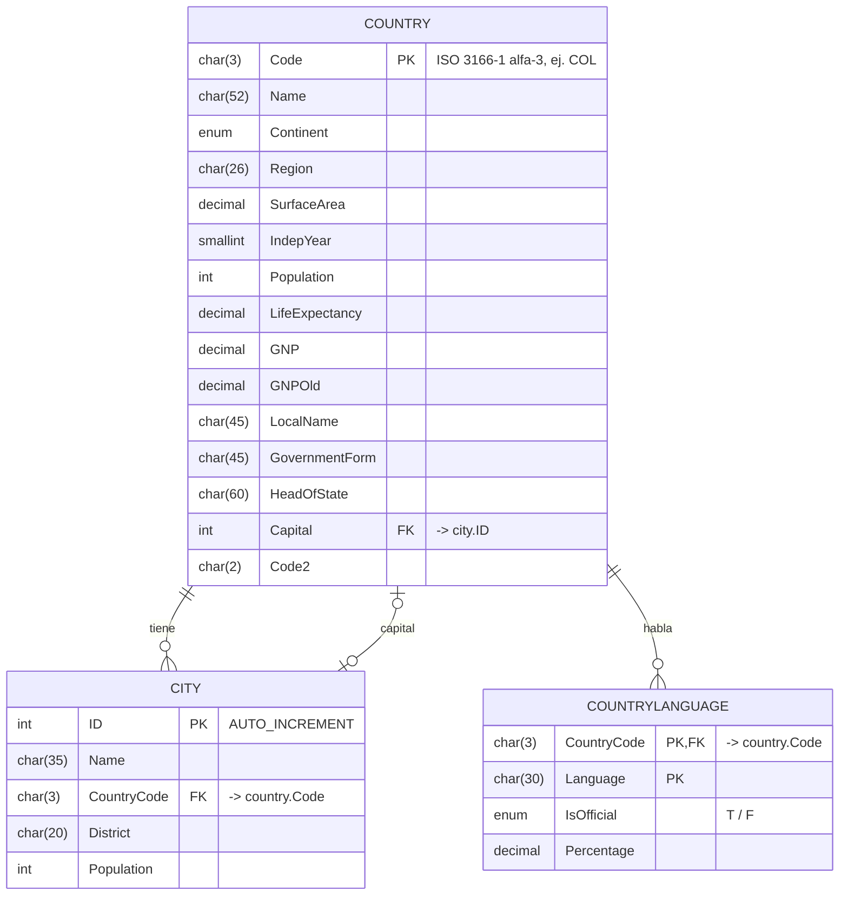

# Diagrama de la base de datos `world`

GitHub dibuja este diagrama automáticamente (Mermaid).

## Relaciones

| Relación | Tipo | Columnas | Explicación |
|---|---|---|---|
| country → city | 1 : N | `city.CountryCode` → `country.Code` | Un país tiene muchas ciudades; cada ciudad pertenece a un solo país. |
| country → countrylanguage | 1 : N | `countrylanguage.CountryCode` → `country.Code` | Un país habla varios idiomas, con su porcentaje y si es oficial. |
| country → city (capital) | 1 : 0..1 | `country.Capital` → `city.ID` | Referencia a la ciudad capital. Puede ser `NULL` (p. ej. Antártida). |

`countrylanguage` usa una **clave primaria compuesta** (`CountryCode`, `Language`): el mismo
idioma no puede repetirse para un mismo país.

> En el script oficial `world.sql` la columna `country.Capital` **no** tiene una restricción
> FOREIGN KEY declarada; la relación es lógica (se usa con un JOIN). Las de `city` y
> `countrylanguage` sí están declaradas como FOREIGN KEY.
