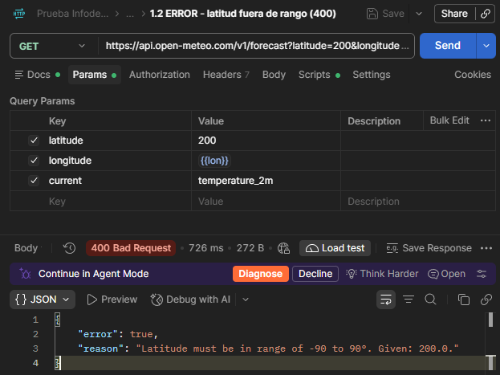
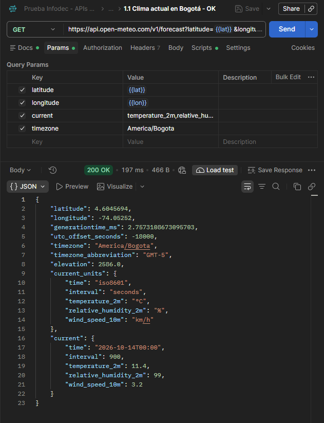
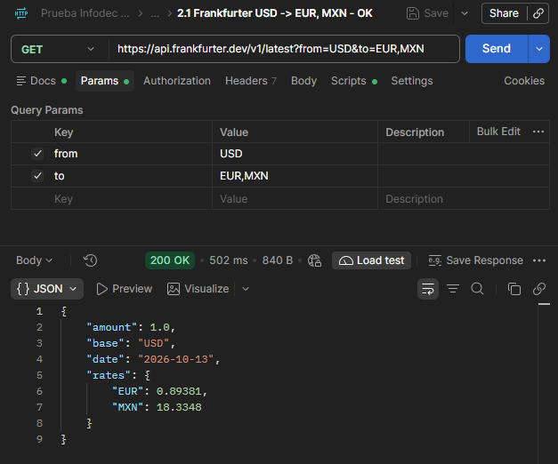
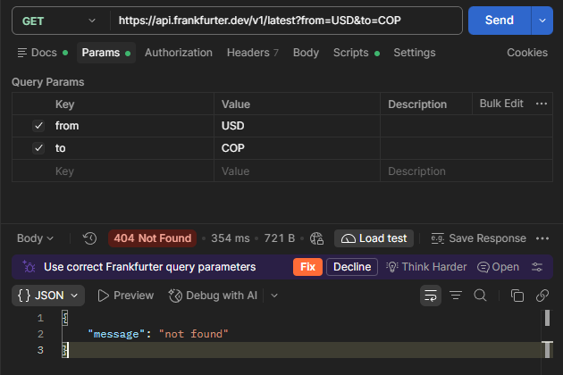
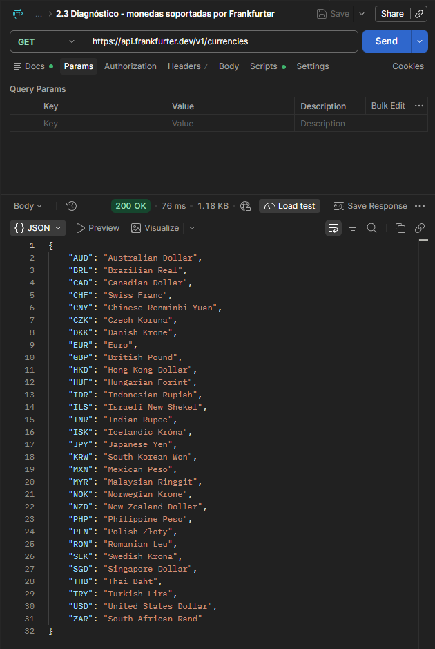
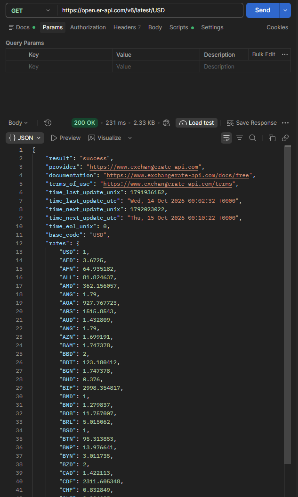

# Pregunta 4 – Consumo de APIs de Clima y Cambio de Moneda con Postman

Colección: [`postman/Prueba-Infodec.postman_collection.json`](../postman/Prueba-Infodec.postman_collection.json)
(en Postman: **Import → seleccionar el archivo**; luego **Run collection** para ejecutar todas las pruebas).

## APIs utilizadas

| API | Uso | Endpoint | API key |
|---|---|---|---|
| [Open-Meteo](https://open-meteo.com/) | Clima actual | `GET https://api.open-meteo.com/v1/forecast` | No |
| [Frankfurter](https://frankfurter.dev/) | Cambio de moneda (tasas del BCE) | `GET https://api.frankfurter.dev/v1/latest` | No |
| [ExchangeRate-API (open access)](https://www.exchangerate-api.com/docs/free) | Cambio de moneda con COP | `GET https://open.er-api.com/v6/latest/USD` | No |

Cada petición tiene **tests automáticos** (pestaña *Tests/Scripts*) que validan el código HTTP
y el contenido de la respuesta.

## Errores identificados

### Error 1 – Clima: `400 Bad Request` por latitud inválida

- **Petición:** `GET /v1/forecast?latitude=200&longitude=-74.08&current=temperature_2m`
- **Respuesta:**
  ```json
  {"reason":"Latitude must be in range of -90 to 90°. Given: 200.0.","error":true}
  ```
- **Diagnóstico:** error del cliente (4xx). El parámetro `latitude` está fuera del rango válido
  (-90 a 90). La API lo indica claramente en `reason`.
- **Solución:** enviar coordenadas válidas (Bogotá: `latitude=4.61&longitude=-74.08`) → `200 OK`.

Error (400):



Petición corregida (200):



### Error 2 – Moneda: `404 Not Found` al convertir USD → COP

- **Petición:** `GET https://api.frankfurter.dev/v1/latest?from=USD&to=COP`
- **Respuesta:**
  ```json
  {"message":"not found"}
  ```
- **Diagnóstico:** la URL y la sintaxis son correctas (con `to=EUR,MXN` responde 200). Se consulta
  `GET /v1/currencies` y se confirma que **COP no está en la lista**: Frankfurter solo publica las
  monedas de referencia del Banco Central Europeo y el peso colombiano no es una de ellas.
  El mensaje "not found" no lo explica, por eso hubo que investigar la lista de monedas.
- **Solución:** cambiar de proveedor a ExchangeRate-API (`https://open.er-api.com/v6/latest/USD`),
  que sí incluye `COP` → `200 OK`.

La misma API funciona con otras monedas (200):



Error al pedir COP (404):



Diagnóstico: la lista de monedas soportadas no incluye COP:



Solución con ExchangeRate-API (200, incluye COP):



## Cómo leer un error HTTP (método de diagnóstico)

1. **Código de estado:** `4xx` = el problema está en la petición (parámetros, autenticación,
   recurso inexistente). `5xx` = el problema está en el servidor.
2. **Cuerpo de la respuesta:** casi todas las APIs explican la causa (`reason`, `message`, `error`).
3. **Documentación:** comparar la petición con lo que la API espera.
4. **Aislar el cambio:** probar una petición que sí funcione y cambiar un solo parámetro a la vez.
