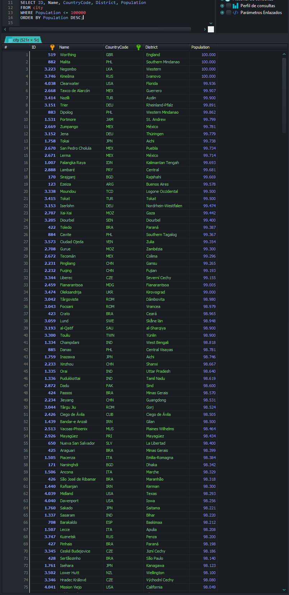
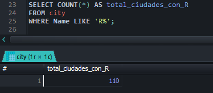
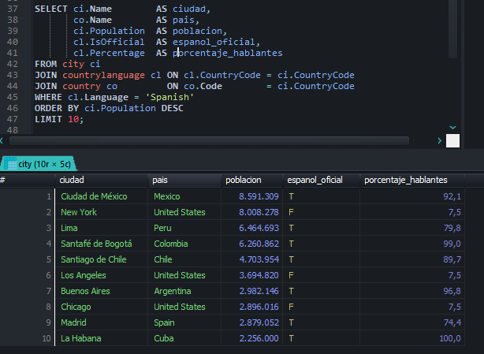
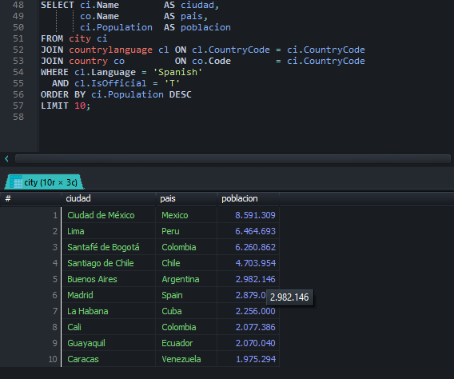

# Respuestas de la prueba

## Pregunta 1 – Aplicación web

Ver el [README](../README.md) (instalación, arquitectura MVC y funcionamiento) y el
[diagrama de la base de datos](diagrama-bd.md).

## Pregunta 2 – Consultas SQL

Los queries están en [`database/consultas.sql`](../database/consultas.sql).

| # | Consulta | Idea clave | Resultado |
|---|---|---|---|
| 1 | Ciudades con población ≤ 100.000 | `WHERE Population <= 100000` | 521 ciudades |
| 2 | Conteo de ciudades que empiezan por "R" | `COUNT(*)` + `LIKE 'R%'` | 110 |
| 3 | Top 10 de ciudades donde se habla español | `JOIN` city ↔ countrylanguage, `WHERE Language = 'Spanish'`, `ORDER BY Population DESC LIMIT 10` | Ver abajo |

### Consulta 1

### Consulta 2

### Consulta 3

El enunciado dice "donde se hable español", y eso se puede entender de dos formas, así que
dejé las dos versiones:

| # | Versión A: se habla español (oficial o no) | Versión B: español idioma oficial |
|---|---|---|
| 1 | Ciudad de México (México) | Ciudad de México (México) |
| 2 | **New York (Estados Unidos)** | Lima (Perú) |
| 3 | Lima (Perú) | Santafé de Bogotá (Colombia) |
| 4 | Santafé de Bogotá (Colombia) | Santiago de Chile (Chile) |
| 5 | Santiago de Chile (Chile) | Buenos Aires (Argentina) |
| 6 | **Los Angeles (Estados Unidos)** | Madrid (España) |
| 7 | Buenos Aires (Argentina) | La Habana (Cuba) |
| 8 | **Chicago (Estados Unidos)** | **Cali (Colombia)** |
| 9 | Madrid (España) | **Guayaquil (Ecuador)** |
| 10 | La Habana (Cuba) | **Caracas (Venezuela)** |

En la base World, Estados Unidos tiene el español registrado como idioma no oficial
(`IsOfficial = 'F'`). Por eso, en la versión literal (A), entran New York, Los Angeles y
Chicago. Si se busca solo países hispanohablantes, la versión B filtra `IsOfficial = 'T'`
y en su lugar entran Cali, Guayaquil y Caracas.

## Pregunta 3 – Modelo de datos

**¿Qué campo es la clave primaria de la tabla País?** → **b. Código** (`country.Code`, `CHAR(3)`).
El nombre podría cambiar o repetirse en otros idiomas; el continente y la capital se repiten
entre países. El código ISO de 3 letras es único y estable.

**¿Cuál es la relación entre Ciudad y País?** → **B. Un país puede tener varias ciudades.**
Es una relación 1 a N: `city.CountryCode` es una clave foránea hacia `country.Code`.
La opción A es falsa (una ciudad tiene un solo `CountryCode`), la C habla de idiomas, que
se relacionan con el país y no con la ciudad, y la D es falsa porque la FK existe.

## Pregunta 4 – Consumo de APIs con Postman

Ver [pregunta4-apis.md](pregunta4-apis.md) y la colección en
[`postman/Prueba-Infodec.postman_collection.json`](../postman/Prueba-Infodec.postman_collection.json).

## Pregunta 5 – Transacción declinada

### Qué se envió (petición)

- Pago con tarjeta **Visa** (`type: "001"`) terminada en **4499**, vence 06/2031.
- Monto **52.349,98 COP**, captura inmediata (`capture: true`).
- `actionList: ["DECISION_SKIP"]`: se omitió la revisión antifraude del comercio (Decision Manager).
  Por lo tanto el rechazo **no** viene de reglas antifraude del comercio.
- La petición está bien formada: tiene todos los datos de tarjeta, monto, moneda y facturación.

### Qué se respondió

| Campo | Valor | Significado |
|---|---|---|
| `status` | `DECLINED` | La transacción fue rechazada. |
| `errorInformation.reason` | `BLOCKED_BY_CARDHOLDER` | **El titular tiene la tarjeta bloqueada.** |
| `errorInformation.message` | `Decline - Blocked by cardholder/contact cardholder.` | Rechazada: bloqueada por el tarjetahabiente; hay que contactarlo. |
| `processorInformation.responseCode` | `9G` | Código del procesador/emisor para "bloqueada por el tarjetahabiente". |
| `responseInsights.category` | `ISSUER_CANNOT_APPROVE_AT_THIS_TIME` (cat. 02) | El banco emisor **no puede aprobar en este momento**: podría aprobarse más adelante, cuando cambie la condición. |
| `cardVerification.resultCode` | `P` | El CVV no fue procesado. |
| `avs.code` | `U` | Verificación de dirección no disponible. |
| `Http_Status` | `201` | La API **sí recibió y procesó** la petición. No es un error técnico ni de integración. |

### Diagnóstico

La transacción fue declinada por el **banco emisor** porque **el tarjetahabiente bloqueó su
tarjeta** (o bloqueó ese tipo de compras, por ejemplo compras por internet o de ese comercio).
No es un problema del comercio, de la pasarela ni de los datos enviados: el HTTP 201 y la
respuesta completa del procesador lo confirman.

### Solución / recomendación

1. Informar al cliente (Daniela Ávila) que su banco rechazó el pago porque la tarjeta está
   bloqueada por ella misma, y que debe **desbloquearla** desde la app o línea de su banco,
   o usar otro medio de pago.
2. **No reintentar automáticamente** el cobro con la misma tarjeta hasta que el cliente
   confirme el desbloqueo: los reintentos seguirán siendo rechazados y las marcas
   pueden penalizar los reintentos excesivos.
3. Una vez desbloqueada, se puede reintentar (categoría 02 = "no puede aprobar *en este momento*").
